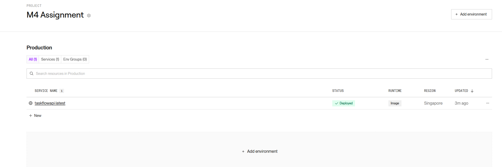
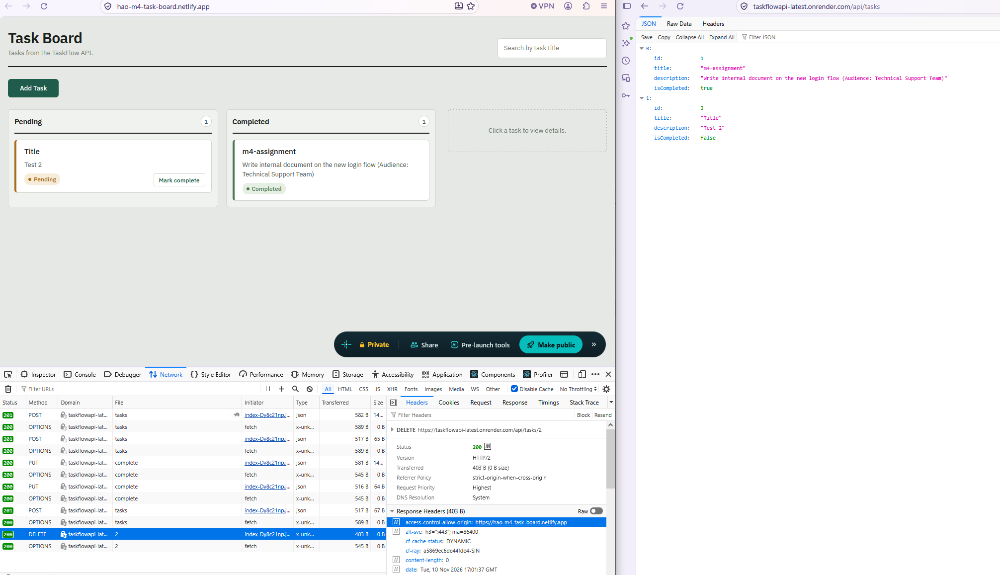
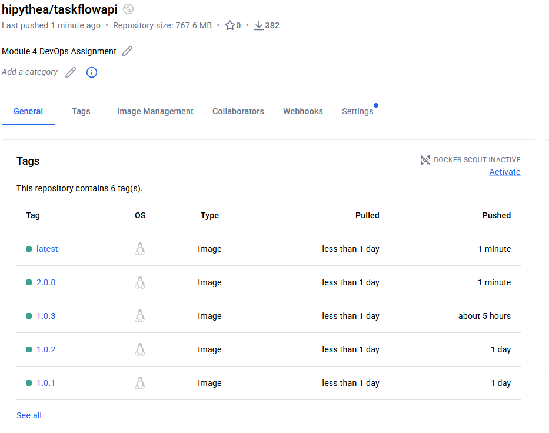
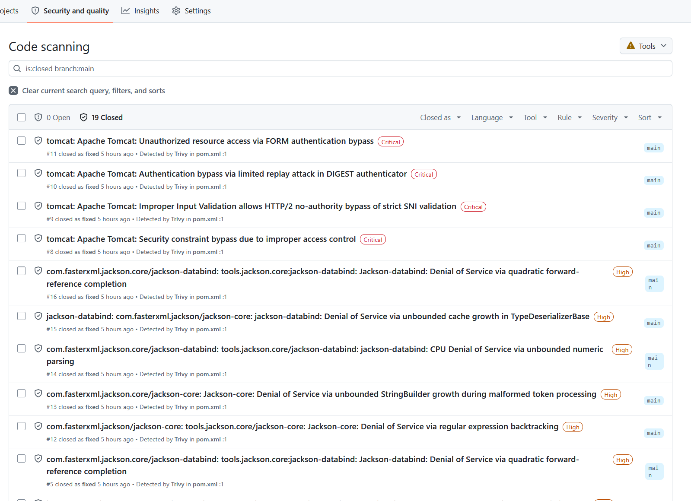

# TaskFlow API

A simple task management REST API adapted from Module 3. Packaged with Docker and deployed to the cloud for the Module 4 assignment.

Tasks are stored in memory, so all data resets when the app restarts.

- **Live API:** https://taskflowapi-latest.onrender.com/api/tasks
- **Frontend (Option 2):** https://hao-m4-task-board.netlify.app ([repo](https://github.com/haolim/aie1f-m4-assignment-task-board))
- **Docker image:** https://hub.docker.com/r/hipythea/taskflowapi

## Endpoints

| Method | Path | Description |
| --- | --- | --- |
| GET | /api/tasks | Get all tasks |
| GET | /api/tasks/{id} | Get one task |
| POST | /api/tasks | Create a task (returns 201) |
| PUT | /api/tasks/{id} | Update a task |
| PUT | /api/tasks/{id}/complete | Mark a task as complete |
| DELETE | /api/tasks/{id} | Delete a task |

## Run locally with Docker
 
```bash
docker build -t taskflow-api .
docker run -p 8080:8080 taskflow-api
```

## Example request body
```json
    {
      "title": "Buy groceries",
      "description": "Milk and eggs",
      "isCompleted": false
    }
```

Dockerfile is a multi-stage build. Stage 1 builds the JAR. Stage 2 copies the JAR into a small JRE image and runs it as a non-root user.


## Deployment

Deployed on Render straight from a Docker Hub image. A deploy hook URL from Render is used by the pipeline after a new image is pushed to trigger a deploy automatically.



## Stretch goals
 
### Option 1: CI pipeline

[`.github/workflows/ci.yml`](.github/workflows/ci.yml) runs on every push to `main`:

1. **build** compiles and packages the app.
2. **test** runs `mvn test` and the Trivy repo scan.
3. **publish** builds the image, scans it using Trivy, pushes it to Docker Hub, then calls the Render deploy hook.

Successful run: https://github.com/haolim/aie1f-m4-assignment-taskflowapi/actions/runs/42858533580

## Option 2: Frontend on Netlify

The Task Board is a React app adapted from module 2 with Claude Code. It calls this API through `VITE_API_URL`.

`CORS_ALLOWED_ORIGINS` is set up as environment variable on Render to allow Netlify origin through.

The Task Board supports create, complete, and delete.



## Option 4: Versioned images

The CI pipeline reads the version from `pom.xml` and tags the image. Two tags are created: the version number (e.g. `2.0.0`) and `latest`. Versions follow Semantic Versioning (MAJOR.MINOR.PATCH). 

I bump the major number for breaking changes (e.g. removed Spring AI and the summary API), patch number for fixes that don't change the API (e.g. security fixes). In hindsight, the CORS change could have been a minor number as it added a new feature.



## Option 5: Security checks

| Tool | Where | What it checks |
| --- | --- | --- |
| Trivy (`trivy fs`) | test job | Dependencies (including transitive), secrets, Dockerfile |
| Trivy (`trivy image`) | publish job | OS packages and libraries inside the built image |
| CodeQL | GitHub default setup | My own Java code and the workflow files |

Trivy scans that have fixable HIGH or CRITICAL issues will fail the pipeline, preventing a vulnerable image from being pushed and deployed.

Trivy found several issues in transitive dependencies:

| Library | Came from | Fix |
| --- | --- | --- |
| Tomcat 11.0.24 (4 CRITICAL) | Spring Boot web starter | 11.0.27 |
| Jackson 3.1.5 (HIGH) | Spring Boot | 3.1.7 |

Upgrading Spring Boot from 4.1.1 to 4.1.2 fixed all of them.



